# AVA Out Run

[](https://github.com/Harlock123/AVAOutRun/actions/workflows/build.yml)

A road racer in the style of Sega's 1986 arcade game **Out Run**, built with .NET 10 and Avalonia UI. A red
convertible, the open road, the radio on, and the clock running. Five stages, and at the end of each the road
forks: left or right, to one of five different goals.

## Features

- **A road drawn the way the arcade did it:** a pseudo-3D road built from segments, with bends that sweep across
  the screen, hills that hide what's over the crest, rumble strips, scenery standing by the roadside, and the
  sky and the far hills shifting as the road turns.
- **Fifteen stages in a branching tree:** Sunset Coast first. Then, by the forks you take, Olive Hills or
  Sandy Bay; Canyon Pass, Old Town or Sea Cliffs; Wheat Fields, Snow Pass, Desert Flats or Lakeside; and
  last, one of five goals: the Observatory, the Ancient Ruins, the Harbour, the Castle or the Vineyard. Each
  has its own sky, land, road and roadside, and the bends get tighter as you go.
- **Beat the clock:** reach each checkpoint before time runs out and the clock is extended. Time left at the
  goal is counted into the score, and the score climbs with your speed.
- **Two gears:** low pulls hard but tops out at 190 km/h; high goes on to 293 km/h, but is sluggish from
  low speed.
- **Bends pull the car wide,** so take a tight one too fast and you're off the road. Off the road the car
  slows, and the palms, rocks, cacti, windmills and houses don't move. Hit one at speed and the car spins or
  rolls; into the back of the traffic, and the speed's gone.
- **The radio:** before the start, tune in to one of three original stations: *Coastline Cruise*, *Silver
  Breeze* or *Night Highway*. Then the lights: red, red, red, green.
- **The announcer speaks:** "Get ready!", "Extended play!", "Goal!" The voice comes from a small formant
  synthesiser in the build tools, so no recording or speech engine is needed. The engine note rises through
  the revs.
- **A route map** in the corner shows the five levels of stages and the road you've taken.
- **The attract mode** shows the computer driver at work. It keeps its foot down in a lane clear of the
  traffic, eases off for bends too tight for its speed, changes gear, and picks its road at each fork.

## Screenshots

| The title | The radio | The lights |
|:---------:|:---------:|:----------:|
| 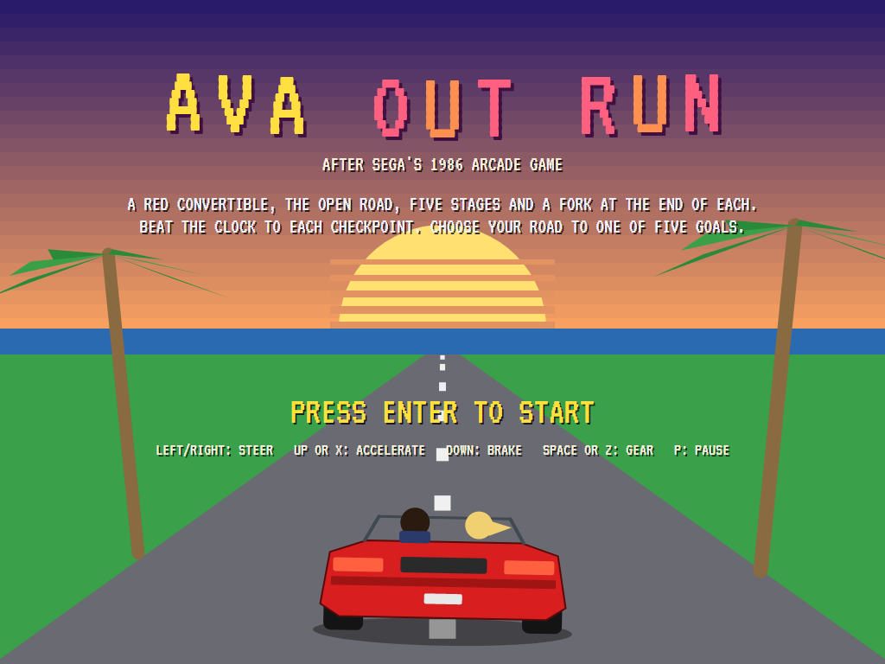 | 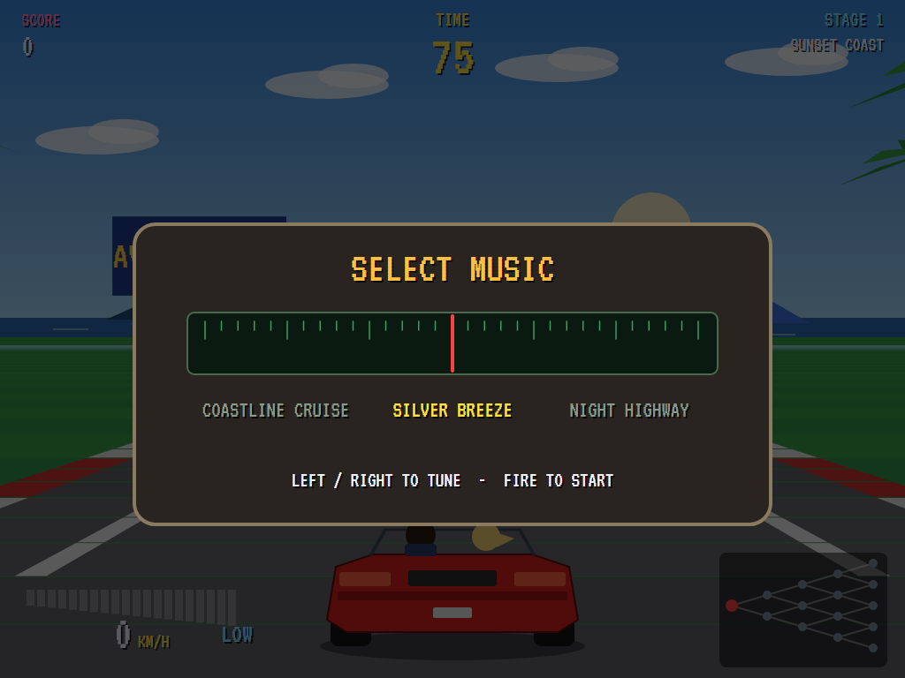 | 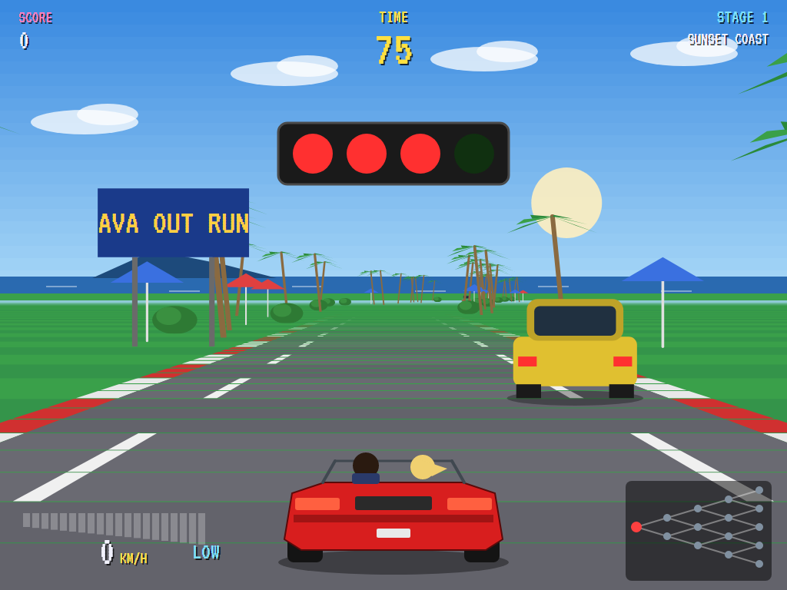 |
| Into the sunset. | Choose a station. | Red, red, red... |

| Sunset Coast | A bend | The fork |
|:------------:|:------:|:--------:|
| 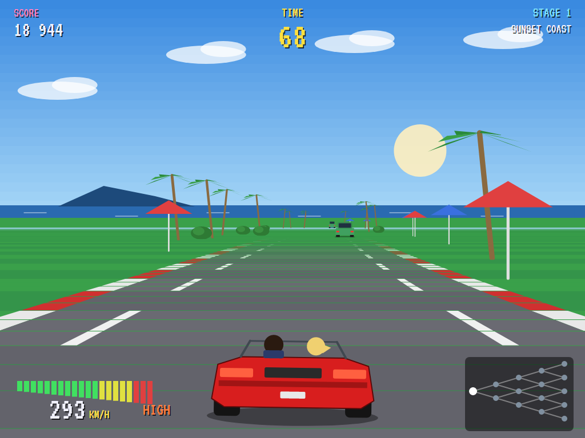 | 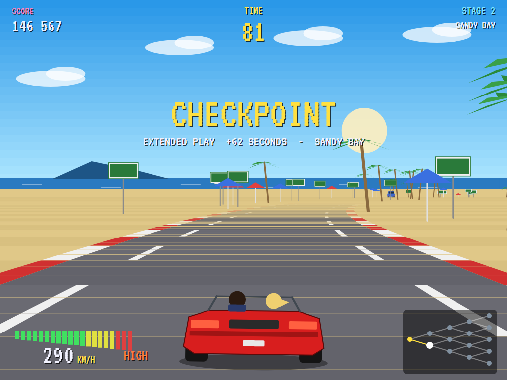 | 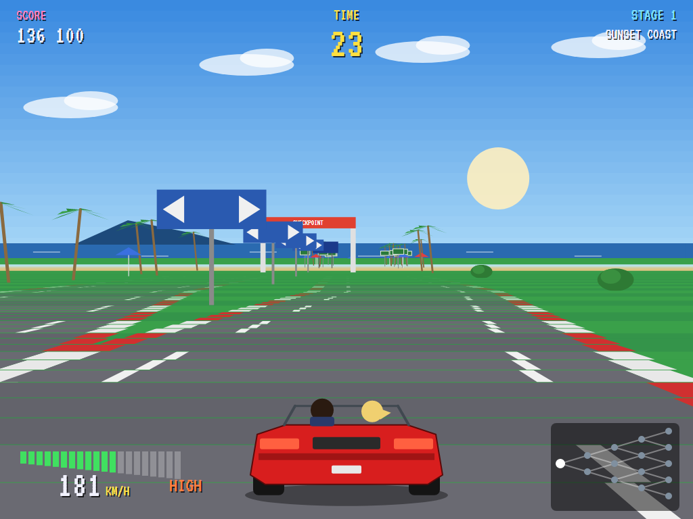 |
| Traffic ahead. | Through Sandy Bay. | Left or right? |

| Checkpoint | Deeper in | Stage four |
|:----------:|:---------:|:----------:|
| 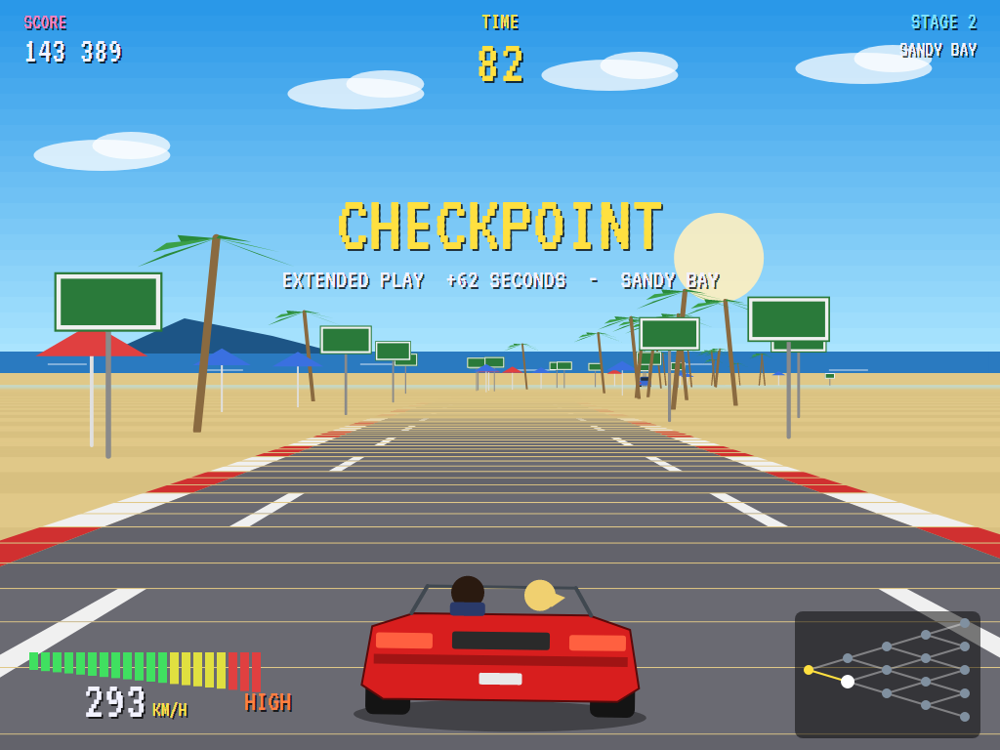 | 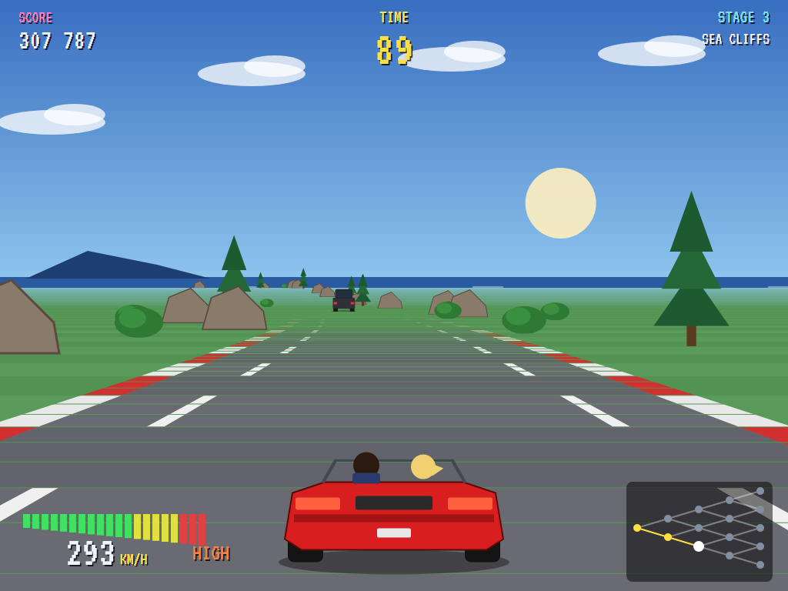 | 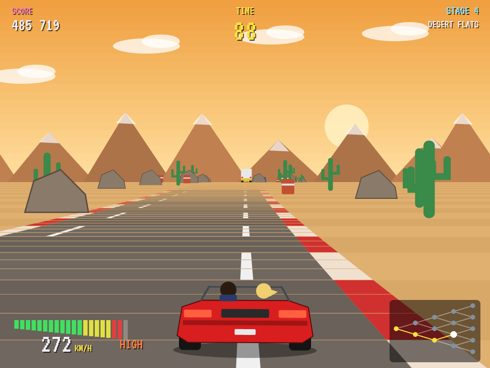 |
| Extended play. | At top speed. | Further down the tree. |

| A crash | Goal | The best out runners |
|:-------:|:----:|:--------------------:|
| 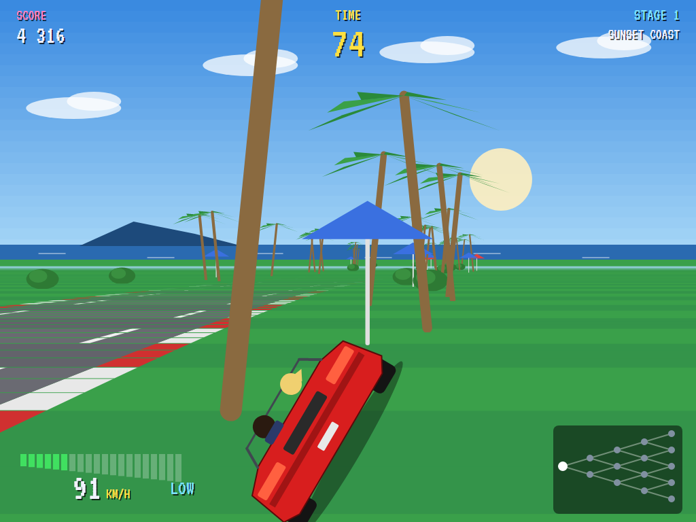 | 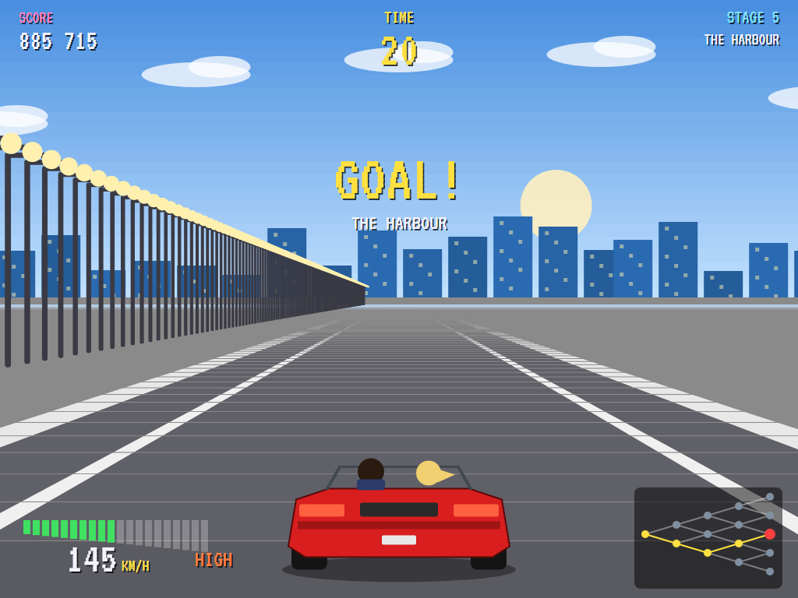 | 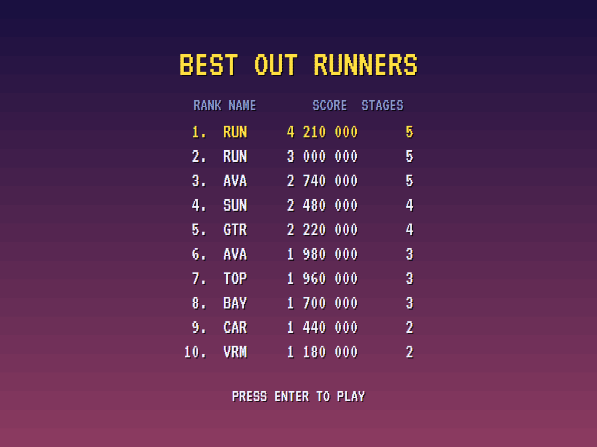 |
| Off the road at speed. | One of five. | The high-score table. |

The screenshots are made by the tests, which play the game in a real (headless) window; see
[Tests](#tests).

## Download and run

Ready-to-run builds for Windows, macOS and Linux, on both Intel/AMD and ARM, are on the
[Releases page](https://github.com/Harlock123/AVAOutRun/releases/tag/latest). **Latest build** is
rebuilt on every push to `main`. Each download is one self-contained executable: no .NET install is
needed.

| Platform | Archive |
|---|---|
| Windows | `AVAOutRun-win-x64.zip`, `AVAOutRun-win-x86.zip`, `AVAOutRun-win-arm64.zip` |
| macOS | `AVAOutRun-osx-arm64.tar.gz` (Apple silicon), `AVAOutRun-osx-x64.tar.gz` (Intel) |
| Linux | `AVAOutRun-linux-x64.tar.gz`, `AVAOutRun-linux-arm64.tar.gz`, `AVAOutRun-linux-arm.tar.gz` |

```bash
tar -xzf AVAOutRun-linux-x64.tar.gz     # or linux-arm64, linux-arm, osx-arm64, osx-x64
./AVAOutRun
```

On Windows, unzip and run `AVAOutRun.exe`. On macOS, if Gatekeeper refuses to open it, run
`xattr -d com.apple.quarantine AVAOutRun` once. Run with `--no-audio` for silence.

**Sound** comes through OpenAL Soft, built in for every platform. In a virtual machine the game
detects it and uses a larger audio buffer, so the sound doesn't break up.

**Gamepads** use SDL2, which is bundled for Windows, macOS and Intel/AMD Linux. ARM Linux builds need it
installed; without it the keyboard still works:

```bash
sudo apt install libsdl2-dev            # Debian / Ubuntu / Raspberry Pi OS
sudo pacman -S --needed sdl2-compat     # Arch / Omarchy
```

## Controls

| Action | Keyboard | Gamepad |
|---|---|---|
| Start | Enter or 1 | Start |
| Steer | Left/right arrows or A/D | Left stick / D-pad |
| Accelerate | Up arrow, W, X or Ctrl | A or right trigger |
| Brake | Down arrow or S | B or left trigger |
| Change gear | Space, Z or Shift | X or Y |
| Tune the radio | Left/right, then accelerate to start | Left/right, then A |
| Pause | P or Esc | Start or Back |
| Sound on/off | M | |
| Screenshot | Ctrl+S (to your Pictures folder) | |

On the high-score table, type your initials, or use up/down and Space, then Enter.

## Tests

```bash
dotnet test AVAOutRun.slnx
```

The game runs in fixed 60 Hz steps, so it plays the same at any frame rate. The tests check:

- **The course:** fifteen stages, each with its own look; every stage starts and ends level, and its bends
  change gently; every stage but the last forks at its end, and the last ends in a goal; the scenery stands
  off the road. The computer driver reaches a goal.
- **Driving:** low gear pulls hard but tops out, and high gear goes on to top speed; from a standstill high
  gear is sluggish; braking slows harder than coasting; a bend pulls the car wide; off the road the car slows,
  and a tree at speed is a crash, after which the car is back on the road in low gear; running into the back
  of a car loses the speed; the fork sends the car down the road it's on, and the clock is extended.
- **The game:** out of time, the car rolls to a stop and the game is over; at a goal the time left is counted
  in; the radio, then the lights, and no moving on red; speed scores and the clock runs; the demonstration
  and the high scores; the keys.

`tests/AVAOutRun.Tests/PilotProbe.cs` reports how the computer driver gets on, for tuning (`OUTRUN_PROBE=1`;
`OUTRUN_PROBE=lazy` for a driver who only holds the accelerator and steers for the middle).

The screenshot tests draw the real screen in a headless window. To refresh the README's pictures:

```bash
OUTRUN_SHOTS=$PWD/Images dotnet test tests/AVAOutRun.Tests --filter ScreenshotTests
```

## Building

```bash
dotnet build AVAOutRun.slnx
dotnet run --project src/AVAOutRun
```

Needs the .NET 10 SDK. The sounds, the engine notes, the voice and the radio's tunes are made by
`tools/make_sounds.py` (standard-library Python, with `tools/speech.py` for the voice):
`python3 tools/make_sounds.py` rewrites `src/AVAOutRun/Sounds`.

## Project structure

```
AVAOutRun/
├── AVAOutRun.slnx
├── src/AVAOutRun/
│   ├── Engine/
│   │   ├── GameEngine.cs        # States, the radio, the lights, the drive, time up and the goal
│   │   ├── Sim.cs               # The car, the gears, bends, the grass, scenery, traffic, the forks
│   │   ├── Course.cs            # The road's measures, segments, and the fifteen stages
│   │   ├── Pilot.cs             # The computer driver (the demonstration, and the tests)
│   │   ├── HighScoreTable.cs, InitialsEntry.cs
│   │   ├── InputHandler.cs, ControllerManager.cs  # Keys and an SDL2 gamepad
│   │   └── SoundManager.cs      # Effects, the engine, the voice and the radio through OpenAL
│   ├── Audio/                   # The OpenAL engine (from the author's AVABand)
│   ├── Views/                   # The drawing: the road in 3D, the scenery, the traffic, the car
│   └── Sounds/                  # The synthesised effects, engine notes, voice and tunes
├── tests/AVAOutRun.Tests/       # Course, gameplay and screenshot tests
├── tools/make_sounds.py, tools/speech.py
└── Images/                      # Screenshots
```

## About and licence

AVA Out Run © 2026 Lonnie Watson, under the [MIT License](LICENSE).

*Out Run* © 1986 Sega; the name belongs to its current owner. AVA Out Run is an independent, unofficial game in
its style. Its car, stages, scenery, graphics, sounds, voice, music and code are its own; nothing is taken from
the original game's program, graphics, sound or music. It is not affiliated with or endorsed by any rights
holder.
